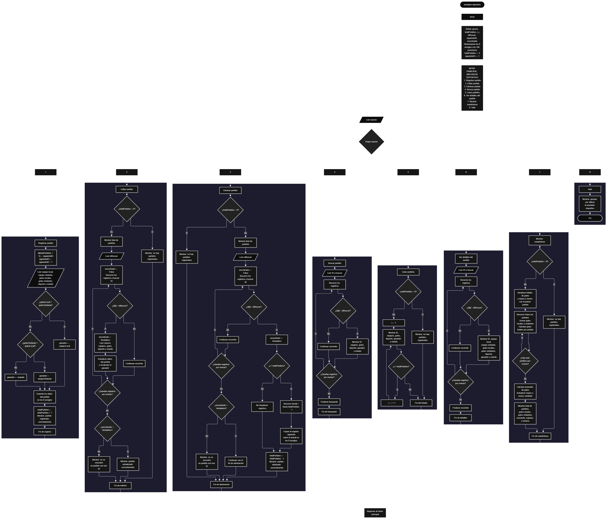

 

Este proyecto, llamado <b>anotador deportivo</b>, fue desarrollado en <b>pseint</b> como un ejercicio práctico para fortalecer la lógica de programación mediante la creación de un sistema de gestión de partidos deportivos desde la consola. El programa cuenta con un menú principal de ocho opciones que permite <b>registrar, editar, eliminar, buscar, listar y consultar la información completa</b> de los partidos, además de mostrar estadísticas generales. Cada partido almacena datos como los equipos participantes, los goles de cada equipo, el deporte, el ganador y el estado del encuentro, utilizando ocho arreglos con una capacidad prevista de <b>100 posiciones durante la ejecución</b>. Durante su desarrollo se aplicaron conceptos fundamentales de programación, como variables, arreglos, estructuras condicionales, ciclos repetitivos y estructuras de selección, además de procesos para buscar, modificar, eliminar y organizar registros. Este proyecto permite poner en práctica los conocimientos adquiridos en PSeInt y sirve como base para desarrollar sistemas de gestión deportiva más avanzados utilizando otros lenguajes y tecnologías.

<h2 align="center">⚙️ Funcionamiento del menú principal</h2>

### ➕ Registrar partido

La opción <b>1) registrar partido</b> permite almacenar un nuevo encuentro deportivo. Al comenzar el registro, el programa asigna un identificador utilizando la variable <b>siguienteID</b> y posteriormente incrementa su valor para generar el próximo identificador. Después, solicita el <b>equipo local, equipo visitante, goles del equipo local, goles del equipo visitante, deporte y estado del partido</b>. Para determinar el ganador, compara los goles de ambos equipos mediante estructuras condicionales. Si los goles del equipo local son mayores, guarda su nombre en el arreglo <b>ganador</b>; si los goles del equipo visitante son mayores, guarda el nombre del equipo visitante; y si ambos equipos tienen la misma cantidad de goles, registra el valor <b>"empate"</b>. Finalmente, incrementa la variable <b>totalPartidos</b> en uno y muestra el mensaje <b>"partido registrado correctamente."</b>. Aunque los arreglos tienen una capacidad de 100 posiciones, el código actual no comprueba si existe espacio disponible antes de registrar un partido.

### ✏️ Editar partido

La opción <b>2) editar partido</b> permite modificar la información de un encuentro deportivo registrado. Primero, el programa comprueba si existen partidos almacenados mediante la variable <b>totalPartidos</b>. Si no hay registros, muestra el mensaje <b>"no hay partidos registrados."</b>. En caso contrario, presenta una lista con el ID, los equipos participantes, los goles, el deporte, el ganador y el estado de cada partido. Después, solicita el identificador del encuentro que se desea editar y utiliza la variable lógica <b>encontrado</b>, inicializada con el valor <b>falso</b>, para comprobar si existe una coincidencia. Cuando encuentra el ID solicitado, cambia <b>encontrado</b> a <b>verdadero</b> y solicita los nuevos equipos, las nuevas cantidades de goles, el deporte y el estado. A continuación, vuelve a determinar el ganador comparando los goles actualizados y modifica los datos directamente en los arreglos correspondientes. Finalmente, muestra el mensaje <b>"partido editado correctamente."</b>. Si el identificador no corresponde a ningún partido registrado, presenta el mensaje <b>"no se encontró un partido con ese id."</b>.

### 🗑️ Eliminar partido

La opción <b>3) eliminar partido</b> permite eliminar un encuentro deportivo mediante su identificador. Antes de comenzar, el programa comprueba si existen partidos registrados. Si no hay encuentros almacenados, muestra el mensaje <b>"no hay partidos registrados."</b>. Si existen registros, presenta una lista con la información de los partidos y solicita el ID que se desea eliminar. Después, inicializa la variable <b>encontrado</b> con el valor <b>falso</b> y recorre los registros hasta localizar el identificador solicitado. Cuando encuentra una coincidencia, cambia la variable a <b>verdadero</b>. Si el partido no ocupa la última posición, utiliza el ciclo <b>para</b>, controlado por la variable <b>j</b>, para desplazar una posición hacia atrás los datos posteriores en los ocho arreglos: <b>id, equipoLocal, equipoVisitante, golesLocal, golesVisitante, deporte, ganador y estado</b>. Posteriormente, disminuye la variable <b>totalPartidos</b> en uno y muestra el mensaje <b>"partido eliminado correctamente."</b>. Si el identificador no corresponde a ningún partido registrado, presenta el mensaje <b>"no se encontró un partido con ese id."</b>. El código actual no limpia explícitamente la última posición ocupada y continúa el recorrido después de eliminar un registro.

### 🔎 Buscar partido

La opción <b>4) buscar partido</b> permite localizar un encuentro deportivo mediante su identificador. Primero, el programa comprueba si existen partidos registrados. Si no hay registros, muestra el mensaje <b>"no hay partidos registrados."</b>. En caso contrario, solicita el ID del partido que se desea buscar e inicializa la variable lógica <b>encontrado</b> con el valor <b>falso</b>. A continuación, utiliza un ciclo <b>para</b> para recorrer los identificadores almacenados y compararlos con el valor introducido mediante la condición <b>id[i] = idBuscar</b>. Cuando encuentra una coincidencia, cambia la variable <b>encontrado</b> a <b>verdadero</b> y muestra el ID, los equipos, los goles, el deporte, el ganador y el estado del encuentro. Si finaliza el recorrido sin encontrar coincidencias, presenta el mensaje <b>"no se encontró un partido con ese id."</b>. La búsqueda recorre los registros sin finalizar anticipadamente cuando encuentra una coincidencia.

### 📋 Listar partidos

La opción <b>5) listar partidos</b> permite visualizar todos los encuentros deportivos registrados actualmente. Antes de mostrar la información, el programa comprueba si la variable <b>totalPartidos</b> es igual a cero. Si no existen registros, presenta el mensaje <b>"no hay partidos registrados."</b>. Si hay partidos disponibles, muestra el mensaje <b>"datos registrados"</b> y utiliza un ciclo <b>para</b> para recorrer los arreglos desde la primera posición hasta el total actual de partidos. Durante el recorrido, presenta el ID, el equipo local, el equipo visitante, los goles de cada equipo, el deporte, el ganador y el estado de cada encuentro. Esta función facilita consultar los registros existentes sin necesidad de buscar cada partido individualmente.

### 📄 Ver detalles del partido

La opción <b>6) ver detalles del partido</b> permite consultar la información completa de un encuentro deportivo específico. Primero, el programa comprueba si existen partidos registrados. Si no hay encuentros almacenados, muestra el mensaje <b>"no hay partidos registrados."</b>. En caso contrario, solicita el identificador del partido que se desea consultar e inicializa la variable lógica <b>encontrado</b> con el valor <b>falso</b>. Después, recorre los identificadores mediante un ciclo <b>para</b> y compara cada uno con el valor introducido. Cuando encuentra una coincidencia, cambia la variable <b>encontrado</b> a <b>verdadero</b> y muestra los datos completos del encuentro en líneas separadas: <b>ID, equipo local, equipo visitante, goles del equipo local, goles del equipo visitante, deporte, ganador y estado</b>. Si no encuentra el identificador solicitado después de recorrer los registros, presenta el mensaje <b>"no se encontró un partido con ese id."</b>.

### 📊 Mostrar estadísticas

La opción <b>7) mostrar estadísticas</b> permite obtener un resumen numérico de los partidos registrados. Primero, el programa comprueba si existen encuentros almacenados. Si no hay registros, muestra el mensaje <b>"no hay partidos registrados."</b>. En caso contrario, inicializa las variables <b>totalGolesLocal</b> y <b>totalGolesVisitante</b> en cero. También inicializa <b>mayorGoles</b> y <b>menorGoles</b> con la suma de los goles de ambos equipos en el primer partido. Después, utiliza un ciclo <b>para</b> para recorrer todos los encuentros, acumular los goles locales y visitantes y calcular la suma de goles de cada partido. Mediante estructuras condicionales, compara esa suma con los valores de <b>mayorGoles</b> y <b>menorGoles</b> para actualizar las cantidades máxima y mínima cuando corresponde. Finalmente, calcula <b>promedioGoles</b> dividiendo el total de goles de ambos equipos entre la cantidad de partidos registrados. El programa muestra el total de partidos, los goles del equipo local, los goles del equipo visitante, el promedio de goles por partido y la mayor y menor cantidad de goles anotados en un encuentro.

### 🚪 Salir del menú principal

La opción <b>8) salir</b> está destinada a finalizar la ejecución del programa y muestra el mensaje <b>"gracias por utilizar el anotador deportivo."</b>. El menú principal se encuentra dentro de una estructura repetitiva <b>repetir ... hasta que</b>, que mantiene el programa en funcionamiento mientras se realizan las operaciones disponibles. En este proyecto, la condición final es <b>hasta que opcion = 8</b>, que coincide con el número asignado a la opción de salida. Por este motivo, cuando el usuario selecciona la opción 8, se muestra el mensaje de despedida y finaliza el ciclo principal.

<h2 align="center">🧠 Temas aplicados en el proyecto</h2>

### 📦 Variables

En este proyecto se utilizan variables para almacenar la opción seleccionada en el menú, controlar la cantidad de partidos registrados, recorrer los arreglos, identificar el partido que se desea editar, eliminar o consultar y comprobar si se encontró una coincidencia. También se emplean variables para generar identificadores consecutivos y calcular las estadísticas relacionadas con los goles de los encuentros. Cada variable cumple una función específica dentro de las operaciones de gestión deportiva.

🔢 **Opcion:** Almacena la opción seleccionada por el usuario en el menú principal.

📊 **TotalPartidos:** Almacena la cantidad actual de partidos registrados.

🔄 **I:** Funciona como contador en los ciclos <b>para</b> y permite recorrer los registros.

🔁 **J:** Controla el recorrido utilizado para desplazar los datos durante la eliminación de un partido.

🔎 **IdBuscar:** Almacena el identificador introducido por el usuario para localizar un partido.

🆔 **SiguienteID:** Genera los identificadores consecutivos de los partidos registrados.

✅ **Encontrado:** Variable lógica que indica si se encontró un partido con el identificador solicitado.

⚽ **TotalGolesLocal y TotalGolesVisitante:** Acumulan los goles anotados por los equipos locales y visitantes.

📈 **MayorGoles y MenorGoles:** Almacenan la mayor y menor cantidad total de goles anotados en un partido.

📊 **PromedioGoles:** Almacena el promedio de goles por partido.

### 🗃️ Arreglos

En este proyecto se utilizan ocho arreglos relacionados con la información de cada encuentro deportivo. Cada arreglo se dimensiona con una capacidad de <b>100 posiciones</b> y utiliza el mismo índice para representar los datos correspondientes a un mismo partido. Por ejemplo, la información del encuentro almacenado en la posición <b>1</b> se encuentra distribuida entre <b>id[1], equipoLocal[1], equipoVisitante[1], golesLocal[1], golesVisitante[1], deporte[1], ganador[1] y estado[1]</b>. Esta organización permite recorrer, buscar, modificar, mostrar y eliminar los partidos mediante sus respectivas posiciones. La capacidad de los arreglos está definida en el código, pero no se comprueba si se ha alcanzado el límite antes de registrar nuevos encuentros.

🆔 **Id[100]:** Almacena los identificadores de los partidos registrados.

🏠 **EquipoLocal[100]:** Almacena los nombres de los equipos locales.

✈️ **EquipoVisitante[100]:** Almacena los nombres de los equipos visitantes.

⚽ **GolesLocal[100]:** Almacena la cantidad de goles anotados por los equipos locales.

⚽ **GolesVisitante[100]:** Almacena la cantidad de goles anotados por los equipos visitantes.

🏆 **Deporte[100]:** Almacena el deporte al que pertenece cada encuentro.

🥇 **Ganador[100]:** Almacena el nombre del equipo ganador o el valor <b>"empate"</b> cuando ambos equipos anotan la misma cantidad de goles.

📌 **Estado[100]:** Almacena el estado de cada partido.

### 🔀 Estructuras condicionales

En este proyecto se utilizan las estructuras <b>si</b> y <b>sino</b> para comprobar si existen partidos registrados antes de realizar determinadas operaciones, comparar los goles de los equipos para determinar el ganador, comprobar si el identificador introducido coincide con alguno de los almacenados y actualizar los valores máximo y mínimo de goles. Estas condiciones permiten que el programa responda de manera diferente según los datos de cada encuentro y el resultado de las operaciones realizadas.

### 🔄 Estructuras repetitivas

En este proyecto se utilizan los ciclos <b>para</b> y <b>repetir ... hasta que</b>. Los ciclos <b>para</b> permiten recorrer los arreglos para mostrar los partidos, buscar identificadores, editar registros, consultar detalles y calcular estadísticas. Durante la eliminación, también se utilizan para desplazar los datos de los partidos posteriores una posición hacia atrás. Por otro lado, el ciclo <b>repetir ... hasta que</b> mantiene activo el menú principal para que el usuario pueda ejecutar diferentes operaciones hasta seleccionar la opción de salida.

### 🎯 Estructura según

El programa evalúa el valor almacenado en la variable <b>opcion</b> y ejecuta el bloque de instrucciones correspondiente. Cada caso representa una operación específica del sistema: <b>registrar partido, editar partido, eliminar partido, buscar partido, listar partidos, ver detalles del partido, mostrar estadísticas o salir</b>. También se utiliza el bloque <b>de otro modo</b> para mostrar el mensaje <b>"opción no válida."</b> cuando el usuario introduce un número que no coincide con ninguna de las opciones definidas en el menú.

### 🔢 Dimensionamiento de arreglos

El programa utiliza la instrucción <b>dimension</b> para establecer la capacidad de los ocho arreglos que almacenan la información de los partidos. Cada arreglo dispone de <b>100 posiciones</b>, lo que establece la capacidad prevista para administrar los encuentros durante la ejecución. La cantidad de registros activos se controla mediante la variable <b>totalPartidos</b>, por lo que las operaciones recorren las posiciones comprendidas entre la primera y el total actual de partidos. Sin embargo, el programa no incluye una condición que impida registrar más encuentros cuando se alcanza la capacidad definida.

### 🔄 Reorganización de registros

Cuando se selecciona un partido para eliminarlo, el programa utiliza un ciclo <b>para</b> que comienza en la posición del registro encontrado y llega hasta <b>totalPartidos - 1</b>. En cada repetición, los datos de la posición siguiente se copian sobre la posición actual en los ocho arreglos: <b>id, equipoLocal, equipoVisitante, golesLocal, golesVisitante, deporte, ganador y estado</b>. Posteriormente, la variable <b>totalPartidos</b> disminuye en uno. De esta manera, los registros posteriores pueden ocupar la posición del partido eliminado sin separar los datos que pertenecen a un mismo encuentro. El código actual no limpia explícitamente la última posición y continúa el recorrido principal después de realizar la eliminación.

<h2 align="center">¿Cómo se implementaron las operaciones crud en el proyecto?</h2>

Las operaciones <b>crud</b> se implementaron mediante las opciones del menú principal, permitiendo administrar los partidos registrados. La operación <b>crear</b> corresponde a <b>registrar partido</b>, donde se introducen los datos de un nuevo encuentro; <b>leer</b> se realiza mediante las opciones <b>buscar partido, listar partidos y ver detalles del partido</b>; <b>actualizar</b> corresponde a <b>editar partido</b>, donde se modifican los datos de un encuentro registrado; y <b>eliminar</b> se realiza mediante la opción <b>eliminar partido</b>. Estas operaciones utilizan variables, arreglos, condicionales y ciclos para gestionar la información almacenada temporalmente durante la ejecución del programa. Además, la opción de estadísticas permite obtener información general sobre los goles registrados en los encuentros.

<h2 align="center">Diagrama de flujo del proyecto</h2>

<h2 align="center">🛡️ Validaciones del programa</h2>

### 📭 No existen partidos registrados

Esta comprobación se utiliza en las opciones de <b>editar, eliminar, buscar, listar, ver detalles y mostrar estadísticas</b>. El programa comprueba si la variable <b>totalPartidos</b> es igual a <b>0</b> y, si no existen encuentros almacenados, muestra el mensaje <b>"no hay partidos registrados."</b>. Esta comprobación evita continuar con las operaciones que necesitan información almacenada cuando no se ha registrado ningún partido.

### ⚠️ Capacidad de los arreglos

El programa utiliza ocho arreglos dimensionados con <b>100 posiciones</b> para almacenar los datos de los partidos. Sin embargo, en la opción de registro no se comprueba si la variable <b>totalPartidos</b> ha alcanzado esa cantidad antes de guardar un nuevo encuentro. Por este motivo, aunque existe una capacidad prevista de 100 posiciones, el código actual no incorpora una validación que impida superar ese límite ni muestra un mensaje específico de arreglos llenos.

### ❌ Partido no encontrado

Esta comprobación se utiliza durante las operaciones de <b>editar, eliminar, buscar y ver detalles del partido</b>. El programa inicializa la variable lógica <b>encontrado</b> con el valor <b>falso</b> y recorre el arreglo <b>id</b> para comparar cada identificador con el valor introducido por el usuario. Cuando encuentra una coincidencia, cambia la variable a <b>verdadero</b> y ejecuta la operación correspondiente. Si al finalizar el recorrido la variable <b>encontrado</b> continúa siendo <b>falso</b>, muestra el mensaje <b>"no se encontró un partido con ese id."</b>. De esta manera, el programa informa cuando el identificador solicitado no corresponde a un registro encontrado.

### 🔢 Identificadores de los partidos

El programa utiliza la variable <b>siguienteID</b> para asignar identificadores consecutivos a los partidos registrados. Inicialmente, esta variable toma el valor <b>1</b> y aumenta en uno cada vez que se registra un nuevo encuentro. De esta manera, cada partido recibe un identificador que se utiliza posteriormente para buscarlo, editarlo, eliminarlo o consultar sus detalles. Cuando se elimina un registro, el identificador de los partidos restantes se conserva durante el desplazamiento de los arreglos, mientras que <b>siguienteID</b> mantiene el valor necesario para asignar el próximo identificador.

### ⚠️ Opción inválida

La estructura <b>segun</b> incluye el bloque <b>de otro modo</b>, que muestra el mensaje <b>"opción no válida."</b> cuando el usuario introduce un número que no corresponde a ninguna de las ocho opciones definidas en el menú principal. La opción de salida está identificada con el número <b>8</b>, y el ciclo principal utiliza la condición <b>hasta que opcion = 8</b> para finalizar la ejecución del programa.

<h2 align="center">🎯 Objetivo del proyecto</h2>

El objetivo principal de este proyecto es fortalecer la <b>lógica de programación</b> mediante el desarrollo de un sistema de gestión de partidos deportivos en <b>pseint</b>. A través de su construcción se busca aplicar los conocimientos adquiridos sobre variables, arreglos, estructuras condicionales, ciclos repetitivos y estructuras de selección, integrándolos para resolver un problema de manera organizada. Además, el proyecto permite comprender cómo registrar, consultar, modificar y eliminar información, determinar automáticamente el ganador de un encuentro a partir de los goles y obtener estadísticas generales de los partidos almacenados. De esta manera, se establece una base para desarrollar sistemas de anotación y gestión deportiva más completos con otros lenguajes y tecnologías.

